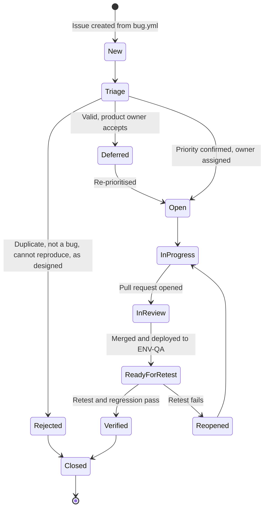

# RiskLens — Test Plan

| Attribute | Value |
| --- | --- |
| Test plan identifier | RL-TP-001 |
| Version / status | 0.1 — Draft for QA and stakeholder review |
| Date | 2026-11-17 |
| Product | RiskLens — AI-Powered Cryptocurrency & Stock Risk Analysis Platform (SRS working title) |
| Requirements baseline | SRS v0.1, 28 October 2026 (Draft; FR-01 to FR-25, US-01 to US-16, NFR-01 to NFR-08) |
| Level of plan | Master test plan for the MVP release, covering system-level, integration-level and acceptance-level testing |
| Author / owner | \[QA Lead — to be completed\] |
| Companion documents | `docs/test-cases.md` (RL-TC-001, 83 test cases), `docs/traceability-matrix.md` (RL-RTM-001), `.github/ISSUE_TEMPLATE/bug.yml` |

### Revision History

| Version | Date | Author | Description |
| --- | --- | --- | --- |
| 0.1 | 2026-11-17 | \[QA\] | Initial draft derived from SRS v0.1 and `bug.yml` |

**Standard note.** This plan follows the outline of IEEE Std 829 (test plan, 16 items). IEEE 829-2008 has since been superseded by ISO/IEC/IEEE 29119-3; the content remains compatible with that standard. The table below maps the IEEE 829 items to the sections of this plan. The SRS itself makes the same kind of standards note for IEEE 830 and ISO/IEC/IEEE 29148.

| IEEE 829 test plan item | Section of this plan |
| --- | --- |
| 1 Test plan identifier | §1.1 |
| 2 Introduction | §1.2 to §1.5 |
| 3 Test items | §2.1 |
| 4 Features to be tested | §2.2 |
| 5 Features not to be tested | §2.3 |
| 6 Approach | §3 |
| 7 Item pass/fail criteria | §4.1 |
| 8 Suspension criteria and resumption requirements | §4.4 |
| 9 Test deliverables | §7.1 |
| 10 Testing tasks | §7.2 |
| 11 Environmental needs | §5.1 to §5.5 |
| 12 Responsibilities | §5.6 |
| 13 Staffing and training needs | §5.7 |
| 14 Schedule | §7.3 |
| 15 Risks and contingencies | §2.4 and §7.4 |
| 16 Approvals | §7.5 |
| *Added:* entry and exit criteria | §4.2 and §4.3 |
| *Added:* defect severity and reporting lifecycle | §6 |

---

## 1. Test Plan Identifier and Introduction

### 1.1 Identifier

**RL-TP-001, version 0.1.** The plan is versioned with the SRS. When SRS v0.2 is issued, this plan, the test cases and the traceability matrix are re-baselined together (see §7.4, risk PR-01).

### 1.2 System Background (from SRS v0.1)

RiskLens lets a retail investor who holds stocks and cryptocurrencies see how risky the *combined* holdings are. It pairs deterministic quantitative metrics (volatility, concentration, historical drawdown) with LLM-generated plain-language explanations, warnings and recommendations (SRS §1.1). The MVP lets a registered user: (1) create portfolios, (2) record stock and crypto positions, (3) view live valuation and PnL, (4) run an AI-assisted risk analysis, and (5) generate, export and archive a consolidated risk report, in English or Russian.

The MVP is a browser-based web client, a stateless backend REST API, a relational data store and a cache, started with a single `docker compose up` (CON-03). It depends on four external parties: market-data provider(s), an LLM provider, an e-mail delivery service and a centralized logging pipeline (SRS §1.2).

| Module | Functional requirements | Principal behaviour |
| --- | --- | --- |
| Auth | FR-01 to FR-04 | Registration, login with Access JWT (15 min) and Refresh Token, logout, password recovery, optional TOTP MFA |
| Portfolio | FR-05 to FR-08 | Portfolio CRUD (limit 10), add assets, quote fetch and cache, strategy tags |
| Position | FR-09 to FR-11 | Valuation, Unrealized and Realized PnL, partial and full closure, target vs. actual allocation |
| Risk | FR-12 to FR-15 | Metric aggregation, LLM analysis (10 s timeout, circuit breaker), alert thresholds, audit trail |
| Report | FR-16 to FR-18 | On-screen risk report, PDF export, report archive |
| Cross-cutting | FR-19 to FR-25 | Audit logging, payload validation, English/Russian i18n, password hashing, REST API, themes, rate limiting |

### 1.3 Objectives

1. Verify that every functional requirement FR-01 to FR-25 behaves as specified, with every requirement covered by at least one active test case (evidence: `docs/traceability-matrix.md`).
2. Verify the scenarios of every user story, in particular the 33 baseline scenarios of the 11 *Must* stories, which are the SRS's first MVP release criterion.
3. Verify the non-functional requirements NFR-01 to NFR-08 against their acceptance thresholds (the SRS's second release criterion).
4. Make the effect of the SRS's open issues visible to the product owner (the third release criterion) by tagging every affected test case (`docs/test-cases.md` §4.2).
5. Establish a defect-reporting process that uses the repository's bug template (§6).

### 1.4 Scope Summary

In scope: the five functional modules, the cross-cutting capabilities and NFR-01 to NFR-08, as specified in SRS v0.1 §2 to §4, tested in the Compose stack with mock providers and, for contract checks only, against live provider sandboxes. Detailed in §2.

### 1.5 References

1. SRS v0.1, *Software Requirements Specification — AI-Powered Crypto & Stock Risk Analysis Platform*, 28 October 2026.
2. `.github/ISSUE_TEMPLATE/bug.yml`, bug report issue form.
3. IEEE Std 829 (test documentation); ISO/IEC/IEEE 29119-3 (successor).
4. ISO/IEC/IEEE 29148:2018 (requirements quality; the SRS applies it).
5. RFC 7519 (JWT), RFC 6238 (TOTP), RFC 9106 (Argon2), RFC 6265 (cookies).
6. OWASP ASVS, OWASP Top 10 and the OWASP Password Storage Cheat Sheet (baselines named by the SRS for FR-20, FR-22 and FR-25).

---

## 2. Test Items and Features

### 2.1 Test Items

The build under test is identified by a commit hash or image tag, recorded in every test-run header.

| Test item | Description | Related requirements |
| --- | --- | --- |
| Web client | Registration, login, portfolio, position, analysis, report, archive, threshold and settings screens; i18n; themes | FR-21, FR-24, NFR-05 |
| Backend REST API | Stateless API: authentication and authorization, validation, orchestration, error handling | FR-01 to FR-03, FR-20, FR-23, NFR-08 |
| Quote service | Provider adapters, TTL cache, last-known-price fallback, freshness metadata | FR-07, DEP-01 |
| Calculation engine | Valuation, PnL, volatility, concentration, drawdown | FR-09, FR-10, FR-12, NFR-01 |
| AI / LLM adapter | Prompt assembly, provider call, timeout, retry, circuit breaker, schema validation | FR-13, DEP-02 |
| Report renderer | On-screen report and server-side PDF with embedded Cyrillic-capable fonts | FR-16, FR-17, DEP-06 |
| Relational data store | Schema, constraints (unique email, limits), cascade delete, UTC timestamps | SRS §5.3 |
| Cache | Quote cache and rate-limit counters | FR-07, FR-25 |
| E-mail adapter | Password-recovery messages | FR-03, DEP-03 |
| Logging integration | Structured audit and error logs with redaction | FR-19, DEP-05 |
| Deployment package | Docker Compose definition, migrations, seed data, sample environment file | NFR-06, NFR-08 |

### 2.2 Features to Be Tested

| Module | Features tested | FRs | User stories | Test cases |
| --- | --- | --- | --- | --- |
| Auth | Registration and uniqueness; password policy; login; token lifetime, refresh and rotation; logout; recovery; MFA; brute-force limiting | FR-01 to FR-04, FR-25 | US-01, US-02, US-03, US-12 | TC-AUTH-01 to TC-AUTH-18 (18) |
| Portfolio | CRUD; 10-portfolio limit; ownership; asset entry and validation; quote cache; tags | FR-05 to FR-08 | US-04, US-05, US-13 | TC-PORT-01 to TC-PORT-14 (14) |
| Position | Valuation; Unrealized PnL; cached-price fallback; decimal precision; closures and Realized PnL; allocation | FR-09 to FR-11 | US-06, US-07 | TC-POS-01 to TC-POS-11 (11) |
| Risk | Metric calculation; LLM payload privacy; timeout, errors and circuit breaker; structured output; thresholds; audit trail | FR-12 to FR-15 | US-08, US-09, US-14 | TC-RISK-01 to TC-RISK-14 (14) |
| Report & Export | On-screen report; chart accuracy; regeneration; missing-data handling; PDF export (English and Russian); archive | FR-16 to FR-18 | US-10, US-11, US-15 | TC-RPT-01 to TC-RPT-09 (9) |
| Cross-cutting | Audit logging; log redaction; SQLi and XSS; payload validation; i18n; password hashing; REST API documentation; themes; rate limiting; authorization | FR-19 to FR-25 | US-16 | TC-SYS-01 to TC-SYS-13 (13) |
| Non-functional | Performance; cross-browser; single-command startup; statelessness | NFR-01, NFR-05, NFR-06, NFR-08 | | TC-NFR-01 to TC-NFR-04 (4) |

Total: **83 test cases** (50 P1, 25 P2, 8 P3). NFR-04 and NFR-07 are verified by a CI gate and by production monitoring (§3.5).

### 2.3 Features Not to Be Tested

**Excluded by the SRS (MVP "will not", §1.5).** These are not built in the MVP, so no positive tests exist for them. Where a boundary is worth protecting, a negative check confirms the exclusion (TC-PORT-12 for OOS-07 and OOS-08; TC-RISK-08 for OOS-01 and OOS-03).

| OOS | Excluded capability |
| --- | --- |
| OOS-01, OOS-03 | Automated trading; automated rebalancing executions |
| OOS-02, OOS-14 | Social trading features; shared portfolios and advisor–client roles |
| OOS-04, OOS-05 | Holdings import from brokers, exchanges or wallets; custody, payments, private keys |
| OOS-06 | Personalised regulated investment advice |
| OOS-07, OOS-08, OOS-09 | Other asset classes; multi-currency and FX; tax, dividends, fees, corporate actions |
| OOS-10 | Native mobile apps; browsers other than latest stable Chrome and Firefox |
| OOS-11, OOS-12 | Social/SSO/passwordless login; administrative web console |
| OOS-13, OOS-15 | Model training or hosting; push/SMS notifications and scheduled or emailed reports |

**Outside the scope of this test plan (not excluded from the product).**

- *Correctness or investment quality of LLM content.* The output is advisory and non-deterministic (ASM-05). Tests verify structure, schema validity, data handling, timeout behaviour and that displayed figures come from computed metrics, not the quality of the advice.
- *Third-party provider behaviour and SLAs.* Provider correctness, latency and licensing are not verified. Only the adapter contract is checked against live sandboxes (§5.3).
- *Legal and regulatory review* (CON-01, OI-17). Counsel's review is outside QA. QA only checks that a disclaimer can be displayed next to AI output (TC-RISK-08).
- *Production availability* (NFR-07). Verified by monitoring after release, not by a pre-release test (§3.5).
- *Load above the NFR-01 baseline* (50 positions per portfolio), long-duration soak, disaster recovery and backup restore. The SRS defines no requirement for them.
- *Accessibility conformance.* The SRS contains no accessibility requirement; recommended for v0.2.
- *Third-party penetration testing.* This plan covers the OWASP-aligned checks of FR-20, FR-22 and FR-25 only.

### 2.4 Software Risk Issues

Test effort and priority follow product risk. The risks below drive the P1 assignments in `docs/test-cases.md`.

| ID | Product risk | Source | Impact | Test response |
| --- | --- | --- | --- | --- |
| RK-01 | Wrong valuation, PnL, concentration or drawdown figures mislead investors | FR-09, FR-10, FR-12 | High | Pre-computed expected values; decimal-precision test; independent oracle for volatility (TC-POS-01 to TC-POS-06, TC-RISK-02) |
| RK-02 | Authentication or session flaws allow account takeover | FR-02, FR-03, NFR-02 | High | Token lifetime, forgery, refresh, logout, enumeration and rate-limit tests (TC-AUTH-05 to TC-AUTH-18) |
| RK-03 | One user can read or change another user's data | ASM-07 | High | Cross-user and anonymous access test across all object types (TC-SYS-13, TC-PORT-04) |
| RK-04 | Injection or XSS through any input | FR-20 | High | Dedicated SQLi, XSS and payload tests (TC-SYS-04 to TC-SYS-06, TC-PORT-11) |
| RK-05 | LLM unavailable, slow, malformed or hallucinating; data leakage to the provider | FR-12, FR-13, ASM-04, ASM-05 | High | Mock failure modes, timeout, circuit breaker, payload privacy, figure integrity (TC-RISK-03, TC-RISK-05 to TC-RISK-07, TC-RISK-10) |
| RK-06 | Quote provider outage or stale data | FR-07, DEP-01 | High | Cached fallback and cold-cache tests with the "Data delayed / cached" indicator (TC-POS-03, TC-POS-04, TC-PORT-13) |
| RK-07 | Secrets leak into logs | FR-19, BR-15 | High | Redaction search over all log sinks (TC-SYS-03) |
| RK-08 | Russian PDF shows missing glyphs | DEP-06 | Medium | Font embedding and text-extraction check (TC-RPT-06) |
| RK-09 | Requirements ambiguity: 17 open issues in SRS §7, five of High severity | SRS §7 | High | Tests parameterised, tagged and listed in `docs/test-cases.md` §4.2 |
| RK-10 | Priority inversions: FR-07 (Should) feeds Must FR-09; FR-22 and FR-25 protect Must FR-01 and FR-02 | OI-01, OI-05 | Medium | Risk-based uplift of those test cases to P1 or P2 |
| RK-11 | Performance misses the 2.0 s p95 target at 50 positions | NFR-01 | Medium | Automated load test with a fixed profile (TC-NFR-01) |

---

## 3. Approach and Test Strategy

### 3.1 Test Levels

| Level | Owner | Scope | Evidence |
| --- | --- | --- | --- |
| Unit | Developers | Business rules, calculations, validators, TOTP, hashing helpers | CI results and coverage report (NFR-04, at least 60% of core services) |
| Integration and API | QA with developers | Service-to-service and service-to-dependency behaviour against mocks: quote cache, LLM adapter, mail, logging, database constraints, cascade delete | TC-PORT-08, TC-PORT-13, TC-RISK-05 to TC-RISK-07, TC-SYS-02 |
| System (end-to-end, UI and API) | QA | Complete user flows through the web client in Chrome and Firefox, plus direct API checks for server-side enforcement | Most test cases in `docs/test-cases.md` |
| Acceptance | Product owner with QA | All *Must* user-story scenarios and the release criteria of SRS §1.1 | §4.3 |

### 3.2 Test Types and Methodology

| Type | What is verified | Method | Examples |
| --- | --- | --- | --- |
| Functional | Each FR and each user-story scenario against its expected result | Requirement-based tests with pre-computed expected values; positive, negative and boundary cases | TC-PORT-03, TC-POS-07, TC-RPT-04 |
| Security | Authentication, session, authorization, injection, secret handling, hashing, rate limiting | Manual tests with a proxy, scripted API abuse cases and an automated scan as a supplement; OWASP ASVS and Top 10 as checklist | TC-AUTH-07 to TC-AUTH-09, TC-SYS-03 to TC-SYS-05, TC-SYS-09, TC-SYS-13 |
| Integration | Behaviour when external parties are slow, failing or hostile | Controllable mocks (market data, LLM, mail, logs), fault injection and a controllable clock | TC-RISK-05 to TC-RISK-07, TC-POS-03, TC-PORT-13 |
| UI and usability | Screens, validation messages, tooltips, indicators, i18n, themes, cross-browser behaviour | Scripted browser tests plus a manual visual pass | TC-AUTH-12, TC-SYS-07, TC-SYS-11, TC-NFR-02 |
| Performance | p95 latency at 50 positions | Load test with a fixed profile and recorded hardware | TC-NFR-01 |
| Localization | English and Russian strings, formats, plurals, PDF glyphs | Catalog diff, UI pass in Russian, PDF text and font extraction | TC-SYS-07, TC-SYS-08, TC-RPT-06 |
| Inspection and analysis | Hash format and salts, route documentation, design checklist, catalog parity | Code and artifact review | TC-SYS-08 to TC-SYS-10, TC-NFR-04 |
| Exploratory | Gaps around risky areas (AI output, quote fallback, auth) | Time-boxed sessions charted by risk, run in each cycle | Findings enter the defect process (§6) |

### 3.3 Test Design Techniques

- *Equivalence partitioning and boundary-value analysis:* password length 7/8 (TC-AUTH-03), 10th and 11th portfolio (TC-PORT-03), quantity and price at zero and at the smallest positive value (TC-PORT-11), threshold range (TC-RISK-12), token lifetime at 14:59 and 15:01 (TC-AUTH-07).
- *State-transition testing:* session and token lifecycle (login, refresh, rotation, logout, expiry), circuit breaker (closed, open, half-open), position (open, partially closed, closed).
- *Decision tables:* quote available or not × cache warm or cold (TC-POS-03, TC-POS-04); analysis possible or not × report possible or not (TC-RISK-04, TC-RPT-04).
- *Oracle-based testing:* expected values come from hand-checked fixtures (Section 2.4 of the test cases) and an independent reference script for volatility.
- *Error guessing and attack patterns:* injection strings, forged tokens, enumeration, race conditions (duplicate registration, double closure).

### 3.4 Prioritization

Test-case priority (P1 to P3, defined in `docs/test-cases.md` §1) is the highest of: the SRS MoSCoW priority of the covered requirement, the priority of the user-story scenario, and a risk-based uplift (§2.4). The execution order in every cycle is P1, then P2, then P3.

### 3.5 Verification of Non-Functional Requirements

| NFR | How it is verified | Test case or evidence | When |
| --- | --- | --- | --- |
| NFR-01 Performance, p95 below 2.0 s at 50 positions | Load test of the position and risk-metric endpoints; the LLM round trip is excluded (OI-03) | TC-NFR-01 | Each release candidate and nightly trend |
| NFR-02 Access JWT 15 minutes | Token claim check and clock-controlled acceptance and rejection | TC-AUTH-05, TC-AUTH-07 | Every cycle |
| NFR-03 Password policy | Boundary tests at API and UI level | TC-AUTH-03, TC-AUTH-04 | Every cycle |
| NFR-04 Coverage of at least 60% | CI coverage gate on the backend core services; the report is attached to the test summary. Coverage type and scope are open (OI-16) | CI report | Every build |
| NFR-05 Chrome and Firefox | End-to-end suite on both browsers | TC-NFR-02 | Each release candidate |
| NFR-06 Single-command startup | Scripted fresh-clone start on a clean machine | TC-NFR-03 | Nightly and each release candidate |
| NFR-07 Availability of at least 99.5% | Synthetic monitoring after release; not a pre-release test. Exclusions are open (OI-16) | Monitoring report | Production, monthly |
| NFR-08 Stateless backend | At least two replicas behind a load balancer; design checklist | TC-NFR-04, TC-SYS-12 | Each release candidate |

### 3.6 Test Data and Mocks

All external dependencies run as mocks in the Compose `mock` profile so that results are deterministic and the single-command promise (NFR-06) holds without secrets. Accounts, quote fixtures, price histories, the LLM failure modes, the mail sink, the log sink, the clock control and the fault-injection hook are specified in `docs/test-cases.md` §2. Rules:

- Every test uses its own users or portfolios, or resets the database to a known seed, so that tests can run in any order.
- Test data contains no real personal data. Addresses use the reserved `example.com` domain.
- Values the SRS leaves open (rate-limit threshold, token lifetimes, cache TTL, circuit-breaker threshold) are named configuration parameters (`CFG-xxx`), and their values are recorded in the run header.
- Time-dependent tests (token expiry, cache TTL, rate-limit windows) use the controllable clock. Real-time waits are the fallback.

### 3.7 Automation Strategy

| Aspect | Decision |
| --- | --- |
| Target | All P1 test cases automated by the end of cycle 2; P2 where cost-effective; P3 by demonstration or manual run |
| Layers | API tests for server-side rules (validation, limits, authorization, tokens); browser tests for flows and UI behaviour; scripts for PDF, log and database checks |
| Browsers | One automated browser project each for the latest stable Chrome and Firefox |
| Proposed tooling (SRS leaves technology open) | A scriptable HTTP client and test runner; a browser automation framework with Chrome and Firefox support; a load tool (k6, JMeter or Locust); an OWASP ZAP baseline scan as a supplement; `poppler-utils` for PDF checks; an OpenAPI validator; a TOTP library |
| CI | Smoke suite on every merge; full P1 regression nightly; full suite and the performance test on release candidates |
| Manual | Exploratory sessions, visual checks of charts and themes, Russian-language review |

### 3.8 Smoke and Regression Suites

- **Smoke (build verification, target under 15 minutes):** TC-NFR-03, TC-AUTH-01, TC-AUTH-05, TC-PORT-01, TC-PORT-09, TC-POS-01, TC-RISK-01, TC-RPT-01.
- **Regression gate:** all 50 P1 test cases.
- **Full regression:** all 83 test cases.

### 3.9 Test Cycles

| Cycle | Purpose | Content |
| --- | --- | --- |
| 0 | Build verification | Smoke suite; unit tests and coverage gate green |
| 1 | Functional | All functional test cases per module; first defect wave; exploratory sessions |
| 2 | Regression and non-functional | Fix verification; full regression; security, i18n, performance, cross-browser and stateless tests |
| 3 | Release candidate | Full P1 regression and the *Must* scenarios on both browsers; acceptance by the product owner; test summary report |

---

## 4. Item Pass/Fail Criteria and Entry/Exit Criteria

### 4.1 Pass/Fail Criteria

**Test case result.**

| Result | Meaning |
| --- | --- |
| Pass | Every step ran and every expected result was observed |
| Fail | At least one expected result was not observed, or an unexpected error (HTTP 500, raw trace, crash) occurred; a defect is raised (§6) and linked to the test case |
| Blocked | A precondition could not be met (environment, missing build, open blocking defect); the blocker is recorded |
| Not run | Not yet executed in this cycle |
| Observation | A step marked "observation", "record" or "not pass/fail" in the test case (it depends on an open SRS issue); the observed behaviour is recorded and, if needed, raised as a clarification |

**Tolerances.** Monetary values are compared to two decimals and percentages to two decimals. Timing assertions use the stated tolerance (for example the LLM timeout between 10.0 and 11.0 s). Indicative timing checks (such as the enumeration check at 100 ms) are recorded, and are escalated only if consistently exceeded.

**Feature (requirement) result.** A requirement passes when all its primary test cases pass and no P1 or P2 defect against it is open. Traceability is in `docs/traceability-matrix.md`.

### 4.2 Entry Criteria

Testing of a cycle starts when:

1. A reviewed requirements baseline exists (SRS v0.1 or later) and the test cases have been reviewed by development and the product owner.
2. A build with a recorded identifier is deployed from a clean checkout with `docker compose up` in the `mock` profile, and the services are healthy (NFR-06).
3. Mocks, fixtures, the clock control and the fault-injection hook are available in the test profile and are absent from production images.
4. The bug template is present at `.github/ISSUE_TEMPLATE/bug.yml`, and the priority labels and status labels used in §6 exist in the repository.
5. Unit tests pass in CI and the coverage report is available (for cycles 1 to 3).
6. The smoke suite passes (cycles 1 to 3).
7. For cycles 2 and 3: all P1 defects from the previous cycle are fixed and ready for retest, or have a documented decision by the product owner.

### 4.3 Exit Criteria (Release Sign-Off)

The criteria operationalise the MVP release criteria in SRS §1.1. The numeric thresholds are proposals for the product owner to ratify.

| # | Criterion | SRS release criterion |
| --- | --- | --- |
| 1 | 100% of P1 test cases executed and passed | (a) |
| 2 | At least 95% of P2 test cases executed; no failed P2 test case without an accepted defect decision; all P3 executed | (a) |
| 3 | All 33 baseline scenarios of the *Must* user stories pass on both latest stable Chrome and Firefox (NFR-05) | (a), (b) |
| 4 | No open P1 defect; no open P2 defect without an accepted workaround and the product owner's sign-off; open P3 defects are listed in the backlog | (a) |
| 5 | NFR-01 to NFR-08 met, or a waiver is recorded in SRS §7 | (b) |
| 6 | Every High-severity SRS open issue (OI-01, OI-02, OI-03, OI-05, OI-17) is resolved or consciously accepted by the product owner | (c) |
| 7 | The traceability matrix shows every FR covered with current results, and no requirement without a passing primary test case | (a) |
| 8 | A test summary report is issued: results by module and priority, defect statistics, deviations and residual risks | n/a |

### 4.4 Suspension and Resumption Criteria

| Suspend testing when | Resume when |
| --- | --- |
| The smoke suite fails on a new build | A new build passes the smoke suite |
| The environment is unavailable or unstable for more than half a working day | The environment is restored and a smoke run passes |
| A P1 defect blocks more than 30% of the test cases planned for the cycle | The fix is deployed and verified, or a workaround is agreed |
| Mock providers misbehave (non-deterministic results, wrong fixtures) | The mock is corrected and the affected test cases are re-baselined |
| The requirements baseline changes in a way that invalidates the cycle's expected results | The test cases are updated and re-reviewed |

Only the affected module or suite is suspended when the cause is local.

---

## 5. Test Environment and Resource Requirements

### 5.1 Environments

| ID | Purpose | Deployment | Providers |
| --- | --- | --- | --- |
| ENV-LOCAL | Developer and tester workstations; authoring and debugging of tests | `docker compose up`, `mock` profile | Mocks only |
| ENV-QA | All scripted regression, security, i18n, performance and cross-browser testing; CI | Compose stack built from the commit under test; the API scaled to at least 2 replicas behind a load balancer for TC-NFR-04 and TC-SYS-12 | Mocks only |
| ENV-STG | Pre-release contract checks of the real adapters; exploratory sessions; release-candidate acceptance | Production-like deployment | Live provider sandboxes or limited-quota keys (§5.3) |

Environment rules: the test-only components (mocks, clock control, fault injection) exist only in the `mock` profile and never in production images; each cycle records the build identifier, environment, browser versions and the values of all `CFG-` parameters in its run header.

### 5.2 Docker Compose Stack

The SRS fixes the containerized, stateless design (CON-03, NFR-06, NFR-08) but leaves technology choices open, so components are named by role.

| Component | Role | Notes for testing |
| --- | --- | --- |
| Frontend | Web client | Served to Chrome and Firefox |
| Backend API | Stateless REST API | Scaled to 2 or more replicas in ENV-QA; no local state or files (NFR-08) |
| Database | Relational data store | Migrations and seed data applied on start; read access for tests that inspect rows and hashes |
| Cache | Quotes and rate-limit counters | Flushable between tests; shared by all replicas |
| `mock-market-data` *(test only)* | Market-data provider mock | Modes MQ-OK and MQ-DOWN; run-time price changes; call counters |
| `mock-llm` *(test only)* | LLM provider mock | Modes ML-OK, ML-SLOW, ML-5XX, ML-429, ML-BAD, ML-HALLU; request capture |
| `mail-sink` *(test only)* | Captures outgoing e-mail | Reset-link retrieval (TC-AUTH-13, TC-AUTH-15) |
| `log-sink` *(test only)* | Receives structured logs | Audit and redaction checks (TC-SYS-01 to TC-SYS-03) |

### 5.3 Mock vs. Live Adapters

| Dependency | Mock (ENV-LOCAL, ENV-QA) | Live (ENV-STG only) |
| --- | --- | --- |
| Market data (DEP-01) | Deterministic quotes, histories and outages; used by all functional and negative tests | Contract check: one quote and one history request per supported asset class, quota-aware (CON-02); verifies the adapter and symbol mapping, not the data |
| LLM provider (DEP-02) | Controlled latency, errors and malformed output; payload capture | A small, cost-limited set of real analyses to confirm the response passes schema validation and respects the 10 s bound |
| E-mail (DEP-03) | Mail sink | One real delivery to a test mailbox to confirm the template and link |
| Logging pipeline (DEP-05) | Log sink | One check that entries reach the real pipeline with redaction intact |

Live checks are run by hand, are never part of automated regression, and use dedicated test keys that are not shared with production.

### 5.4 Client Requirements

- Latest stable Google Chrome and Mozilla Firefox on a supported desktop operating system (ASM-06, NFR-05); exact versions are recorded per run. Other browsers and mobile devices are out of scope (OOS-10).
- Viewports 1366×768 and 1920×1080; OS or browser light/dark and language settings controllable for TC-SYS-07 and TC-SYS-11.
- JavaScript enabled; browser developer tools or an intercepting proxy for token, cookie and header inspection.

### 5.5 Tools and Test Data Management

| Need | Proposed tool or approach |
| --- | --- |
| Test management and results | Execution results recorded per test case ID in a test-management tool or the CI report; failed cases link to a GitHub issue |
| API and security checks | HTTP client with scripting; intercepting proxy; OWASP ZAP baseline scan |
| Browser automation | Framework with Chrome and Firefox projects |
| Performance | k6, JMeter or Locust, with the profile and hardware recorded (OI-16) |
| PDF checks | `pdfinfo`, `pdftotext`, `pdffonts`, `pdftoppm` |
| TOTP | A library implementing RFC 6238, plus the Appendix B vector |
| API documentation | An OpenAPI 3.x validator |
| Test data | Versioned fixture files for users, quotes, price histories S-DD and flat, and portfolios; scripts that reseed the database before each suite; the oracle script for volatility under `tests/oracle/` |

### 5.6 Responsibilities

| Role | Responsibilities |
| --- | --- |
| QA Lead | Owns this plan; assigns and tracks cycles; chairs defect triage; reports status; maintains the traceability matrix |
| QA Engineers | Review and execute test cases; build automation and mocks; file defects through the bug template; verify fixes |
| Developers | Unit tests and the coverage gate; fix defects; provide the test profile (mocks, clock control, fault injection) and build identifiers |
| Product Owner | Resolves the SRS open issues that affect expected results; ratifies exit criteria; arbitrates defect priority; accepts or waives per §4.3 |
| DevOps / SRE | Compose stack, CI pipelines, environments, monitoring for NFR-07 |
| Security reviewer | Reviews the security test cases; confirms hashing parameters and the injection and XSS results |
| Russian-language reviewer | Reviews UI strings, plural forms and the Russian PDF |

### 5.7 Staffing and Training

At least two QA engineers (one with browser and API automation experience, one with security testing experience) and access to a Russian-speaking reviewer. Required knowledge: JWT and refresh-token flows, TOTP (RFC 6238), OWASP ASVS and Top 10, the cost-basis and PnL formulas in SRS §2.4, and the risk-metric definitions in SRS §2.5 once the methodology appendix (OI-09) is published. A one-hour walkthrough of the SRS and this plan is held for new team members.

---

## 6. Defect Severity Classification and Reporting Lifecycle

Defects are reported as GitHub issues created from the repository's bug form, `.github/ISSUE_TEMPLATE/bug.yml`. This section reproduces that schema exactly and defines how the plan's severity classification, lifecycle and evidence rules work with it.

### 6.1 The Bug Report Template (`bug.yml`)

| Property | Value in `bug.yml` |
| --- | --- |
| Form name | `🐛 Bug Report` |
| Form description | `Report a bug or unexpected behavior in RiskLens` |
| Issue title prefix | `[Bug]: ` |
| Labels applied automatically | `bug` |
| Introductory text (markdown block) | `Please provide detailed information to help us reproduce and resolve the issue quickly.` |

| # | Field id | Type | Label | Help text | Placeholder / options | Required |
| --- | --- | --- | --- | --- | --- | --- |
| 1 | `description` | textarea | Bug Description | What happened and how does it manifest? | Describe the expected vs actual behavior. | Yes |
| 2 | `steps` | textarea | Reproduction Steps | How can we reproduce this bug? | `1. Navigate to...`, `2. Enter portfolio...`, `3. Click button...` | Yes |
| 3 | `priority` | dropdown | Priority | n/a | `P1 (Critical — system crash, incorrect risk calculations)` `P2 (Medium — UI/UX bug, validation error)` `P3 (Low — minor styling issue, typo)` | Yes |

The plan uses the three fields without change. Information the form has no field for is carried inside the two text areas as described in §6.4.

### 6.2 Severity and Priority Classification (P1 to P3)

The form has one `Priority` field whose options carry the severity definitions. This plan uses the same P1 to P3 scale for defect priority, so the template's option wording is the authoritative definition and the plan adds SRS-based examples. (The "H/M/L" severities in SRS §7 classify *requirement* open issues, not defects.)

| Priority | Definition in `bug.yml` | Additional examples for RiskLens (plan extension, based on the SRS) | Release impact | Target (proposed) |
| --- | --- | --- | --- | --- |
| **P1 — Critical** | System crash, incorrect risk calculations | Core flow crashes or returns HTTP 500; wrong volatility, concentration or drawdown; wrong valuation, Unrealized or Realized PnL (financial calculations, treated like risk calculations); authentication bypass, forged or non-expiring token accepted; one user can read or change another's data; SQL injection or stored XSS succeeds; passwords stored in plaintext or secrets written to logs; data loss or wrong cascade deletion; a *Must* scenario cannot be completed and has no workaround | Blocks release; testing of the affected area is suspended if it blocks more than 30% of the cycle (§4.4) | Triage the same working day; fix and retest before release candidate |
| **P2 — Medium** | UI/UX bug, validation error | Wrong or missing validation or error message; missing "Data delayed / cached" indicator; untranslated Russian string; a *Should* or *Could* function misbehaves; wrong sort order; PDF defect with a workaround; an NFR threshold missed (see note); behaviour with a workaround | Fixed before release, or accepted with a workaround by the product owner (§4.3, criterion 4) | Triage within 2 working days; fix in the current cycle |
| **P3 — Low** | Minor styling issue, typo | Cosmetic misalignment, wording or typo, minor theme contrast issue | Does not block release | Triage in the weekly review; backlog |

*Note on NFR misses:* an NFR miss such as p95 above 2.0 s is filed as P2 by default and is release-blocking through exit criterion 5 until fixed or waived in SRS §7.

*Rules.* Priority reflects impact on the user, not the priority of the failing test case. A failed P1 test case normally yields a P1 or P2 defect, but the triager decides from the impact. When in doubt the higher priority is used, and the product owner arbitrates disputes. Security defects are never downgraded below P2 without the security reviewer's agreement.

### 6.3 Defect Lifecycle

GitHub issues have only the states open and closed. The plan therefore adds a status label (or a field in a GitHub Projects board) for the stages. The labels are repository conventions and are *not* part of `bug.yml`, which applies only the `bug` label.

| State | Entry condition | Owner | GitHub representation |
| --- | --- | --- | --- |
| New | Reporter submits the form | Reporter | Open issue with label `bug`; title starts with `[Bug]: ` |
| Triage | Within the target in §6.2 | QA Lead with a developer | Add label `P1`, `P2` or `P3` matching the form's `Priority` (or correct it); add a module label |
| Rejected | Duplicate, not a bug, not reproducible, behaves as specified | QA Lead | Comment with the reason; label `status:rejected`; close |
| Deferred | Valid but accepted for later by the product owner | Product Owner | Label `status:deferred`; stays open, no release milestone |
| Open | Confirmed and assigned | Developer | Assignee and milestone set |
| In Progress | Fix under way | Developer | Label `status:in-progress` or board column |
| In Review | Pull request open | Developer, reviewer | Pull request references the issue (`Fixes #n`) |
| Ready for Retest | Fix merged and deployed to ENV-QA | QA Engineer | Label `status:ready-for-retest` |
| Verified | The original test case and the related regression pass | QA Engineer | Comment with the build identifier and result |
| Reopened | Retest fails or the defect recurs | QA Engineer | Reopen the issue, label `status:reopened`, comment with evidence |
| Closed | Verified or rejected | QA Lead | Issue closed |

Repository labels to create: `P1`, `P2`, `P3`, the module labels `auth`, `portfolio`, `position`, `risk`, `report`, `cross-cutting`, and the `status:*` labels above. A small repository automation that copies the form's `Priority` value into the `P1`/`P2`/`P3` label is recommended (§6.6).

### 6.4 How to Fill the Template

**Bug Description** (field `description`) states what happened and how it differs from the expected result, in this order:

1. One-sentence summary.
2. **Expected** result, citing the requirement or test case (for example `FR-09`, `TC-POS-02`).
3. **Actual** result, with the exact message, value or behaviour.
4. **Environment:** build identifier or commit, environment (ENV-QA or ENV-STG), browser and version, locale, mock modes, `CFG-` values that matter.
5. **Evidence:** screenshot or recording, HAR file or request and response, correlation ID and the matching log lines.
6. Frequency (always, intermittent with the observed rate).

**Reproduction Steps** (field `steps`) is a numbered list that starts from a known state:

1. First line: `Test case: TC-xxx-nn` (if the bug was found by a test case or exploratory session, say so).
2. Test data used (user, portfolio fixture, for example `U1`, `P-STD`).
3. Numbered steps in the form of the placeholder (`1. Navigate to...`).

**Priority** (field `priority`) is chosen with the §6.2 definitions. The reporter proposes it and the triager confirms it.

*Illustrative example (not a real defect):*

> **Title:** `[Bug]: Total Unrealized PnL does not change after price update (TC-POS-02)`
>
> **Bug Description:** After the market price changes, the portfolio header still shows the old total. Expected (TC-POS-02, FR-09): after BTC 70,000.00 and AAPL 190.00 the header shows total market value $36,900.00 and Unrealized PnL +$5,100.00 (+16.04%). Actual: header keeps $34,500.00 and +$2,700.00 (+8.49%), while the row values update. Environment: build `a1b2c3d`, ENV-QA, Chrome (version recorded), English, MQ-OK, CFG-QUOTE-TTL 60 s. Evidence: screenshot and response of the valuation endpoint attached; correlation ID `7f3e…`. Frequency: always.
>
> **Reproduction Steps:** 1. Test case: TC-POS-02. Data: U1, P-STD. 2. Log in as U1 and open P-STD; note the header. 3. Set the mock prices as above and advance the clock beyond the quote TTL. 4. Reload the page. 5. Compare the header with the sum of the rows.
>
> **Priority:** `P1 (Critical — system crash, incorrect risk calculations)` (incorrect financial calculation)

### 6.5 Triage, Retest and Closure Rules

- Triage meets at least daily during test cycles and weekly otherwise. Attendees: QA Lead, a developer and, for disputes, the product owner.
- A defect needs the Bug Description, the Reproduction Steps and a Priority to enter triage. Incomplete reports are returned to the reporter with a comment and stay in *New*.
- Duplicates are closed with a link to the original; the original gets the new evidence.
- Every defect found by a test case links to it, and the test-case result is recorded as *Fail* with the issue number. A fix is verified by re-running the failing test case and the regression suite of the affected module.
- A defect is closed only by QA after verification on a build that contains the fix, or by the QA Lead when rejected. Developers do not close verified defects themselves.
- A reopened defect keeps its history; a reopen rate above 10% in a cycle is reviewed in the retrospective.
- A defect that depends on an SRS open issue (for example OI-08 cost basis) is raised as a requirement clarification, linked to the issue, until the product owner decides.

### 6.6 Metrics and Reporting

Reported daily during cycles 1 to 3 and in the test summary report: test cases by result and priority; open defects by priority and module; defects found per cycle versus fixed; reopen rate; mean time from *New* to *Verified* by priority; requirements with failing or not-run primary test cases (from the traceability matrix).

### 6.7 Template Limitations and Recommendations

The plan works with the current `bug.yml` unchanged. The following observations are recommendations for the template owner and do not change the schema used above.

1. The form has no fields for build, environment, browser, test case, affected requirement or attachments. The plan therefore requires them inside the two text areas (§6.4). Optional dedicated fields would make triage faster and allow filtering.
2. The form applies only the `bug` label. The `Priority` choice is not turned into a label automatically, so a small automation (or the triager) must add `P1`, `P2` or `P3`.
3. The P1 definition names crashes and incorrect risk calculations only. Security and data-isolation defects, central to this product, are covered by the plan's examples in §6.2 but not by the template text. Adding them to the P1 option wording would remove the ambiguity.
4. The `Priority` option labels mix severity and priority. The plan treats them as one scale; if business priority and technical severity ever need to diverge, a second field would be needed.

---

## 7. Supporting Test Plan Content

### 7.1 Test Deliverables

| Deliverable | Description | Owner | When |
| --- | --- | --- | --- |
| Test plan | This document (RL-TP-001) | QA Lead | Before cycle 0 |
| Test cases | `docs/test-cases.md` (RL-TC-001) | QA Engineers | Reviewed before cycle 1 |
| Traceability matrix | `docs/traceability-matrix.md` (RL-RTM-001) | QA Lead | Updated each cycle |
| Test data, mock specifications and oracle | Fixtures, mock modes, `tests/oracle/` | QA with developers | Before cycle 1 |
| Automated test suites | API, browser, performance and security scripts; CI jobs | QA Engineers | Per §3.7 |
| Test execution results | Per-test-case results with build, environment and browser versions | QA Engineers | Each cycle |
| Defect reports | GitHub issues from `bug.yml` | All | Continuous |
| Test summary report | Results by module and priority, defects, deviations, residual risks, exit-criteria status | QA Lead | End of cycles 2 and 3 |
| Coverage and performance reports | CI coverage report (NFR-04); load-test report (NFR-01) | DevOps, QA | Each build and release candidate |

### 7.2 Testing Tasks

1. Review the SRS and raise questions on the open issues (SRS Appendix B, items 1 to 4).
2. Review test cases with development and the product owner; agree the `CFG-` parameter values.
3. Build the test profile: mocks, fixtures, clock control and fault injection; verify NFR-06 startup.
4. Create the repository labels and the triage routine of §6.
5. Execute cycles 0 to 3 (§3.9); raise, triage and verify defects.
6. Maintain the traceability matrix and regenerate it after every change to the test cases.
7. Re-baseline the plan, test cases and matrix when SRS v0.2 is issued.
8. Produce the test summary report and obtain sign-off.

### 7.3 Schedule

Calendar dates depend on the development plan, which the SRS does not contain. The milestones below are relative.

| Milestone | Relative timing | Output |
| --- | --- | --- |
| M0: plan and test cases approved | Before the first feature-complete build | RL-TP-001, RL-TC-001, RL-RTM-001 approved |
| M1: test profile and smoke suite ready | With the first deployable Compose stack | Mocks, fixtures, smoke suite in CI |
| M2: cycle 1 complete | After feature complete | All functional results; defect wave 1 |
| M3: cycle 2 complete | After fixes of wave 1 | Regression, non-functional and security results |
| M4: release candidate verified | Code freeze | Cycle 3 result; test summary report |
| M5: sign-off | After the exit criteria of §4.3 are met | Release decision by the product owner |

### 7.4 Planning Risks and Contingencies

| ID | Risk | Likelihood | Contingency |
| --- | --- | --- | --- |
| PR-01 | SRS v0.1 is a draft; five High-severity open issues and several undefined values may change expected results | High | Parameterised tests and OI tags; regenerate the matrix; hold a review of OI-01, 02, 03, 05 and 17 before cycle 1 |
| PR-02 | Mocks differ from real providers (latency, error shapes, symbol coverage) | Medium | Live contract checks in ENV-STG (§5.3); update mocks from observed behaviour |
| PR-03 | Time-dependent tests are flaky or slow without clock control | Medium | Make the clock control part of the test profile; otherwise run those tests nightly with real waits |
| PR-04 | The LLM mock hides real-model behaviour (long outputs, odd formats) | Medium | A small live LLM check in ENV-STG; schema validation tests with malformed samples |
| PR-05 | Provider quotas or cost limit live checks | Low | Keep live checks few and manual (CON-02) |
| PR-06 | Browser updates change behaviour during testing | Low | Record versions per run; re-run the browser suite on a new stable version |
| PR-07 | Limited availability of Russian-language review | Medium | Schedule the review early; rely on the catalog-parity and PDF checks in the meantime |
| PR-08 | Multi-lot cost-basis cases cannot be asserted until OI-08 is decided | Medium | Single-lot tests only for now (TC-POS-07, TC-POS-10); add multi-lot cases after the decision |
| PR-09 | Automation effort for P1 test cases exceeds capacity | Medium | Automate API-level P1 tests first; keep browser tests to the smoke and Must scenarios |

### 7.5 Approvals

| Role | Name | Signature | Date |
| --- | --- | --- | --- |
| QA Lead | | | |
| Product Owner | | | |
| Development Lead | | | |
| DevOps / SRE | | | |
| Security reviewer | | | |
